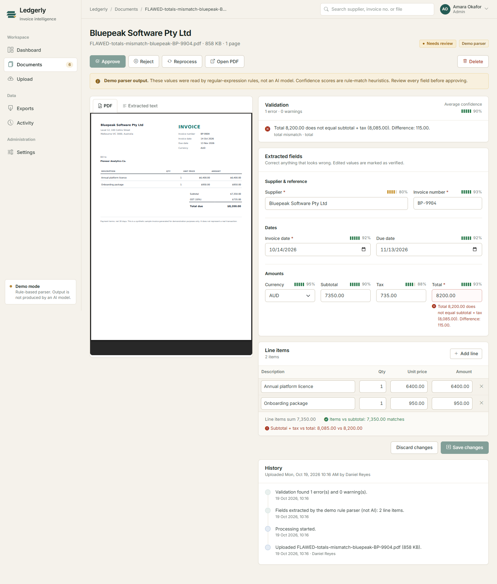

# Ledgerly — Invoice Intelligence

A Laravel application that turns supplier invoice PDFs into reviewed, validated, export-ready data.
Upload a PDF, get supplier / dates / totals / line items extracted, let the app check the arithmetic and
flag duplicates, then have a person approve each record before it reaches CSV or JSON.

> Built by CoreHives as a portfolio project. All bundled documents are **synthetic sample data**.



## What it does

| Area | Details |
|---|---|
| **Upload** | Multi-file PDF upload with drag and drop, client-side checks (type, size, count) and server-side checks (MIME sniffing, `%PDF-` signature, size, count). Files are stored privately under random names. |
| **Extraction** | `demo` rule-based parser (local, free, **not AI**), or live `openai` / `anthropic` through one provider interface. Output is normalised (amounts, dates, currency) and stored with per-field confidence. |
| **Validation** | Required fields, formats, due date before invoice date, future/old dates, currency support, negative amounts, unusual tax rate, `subtotal + tax = total`, line items sum to subtotal, `qty × unit = amount`, low-confidence fields, duplicate invoice (supplier + number) and duplicate file (SHA-256). Errors block approval; warnings do not. |
| **Human review** | PDF preview next to editable fields and line items. Live cross-checks while typing. Edited values are marked *Verified*. Approve, reject (with reason), reopen, reprocess, delete (admin). |
| **Exports** | CSV and JSON of the current filter. Defaults to approved records only. Every record is labelled `demo_parser` or `live_ai`. CSV cells that start with `= + - @` are neutralised against formula injection. |
| **Audit trail** | Every upload, extraction, validation, edit, decision and export is logged and visible per document and on the Activity page. |
| **Order & billing details** | PO number, supplier address and tax ID, bill-to name and address, payment terms, discount, shipping, bank account (masked outside the edit form and in exports), invoice notes, and per-line SKU and tax rate. All are extracted, editable and exported. |
| **Purchase-order matching** | A PO register (add manually or import CSV). Each invoice is checked against its PO: on file, supplier and currency agree, PO still open, the invoice does not exceed the PO value, and invoices already raised against the same PO are counted. Adding or closing a PO re-checks open invoices. |
| **Branding & approval record** | Admins upload a workspace logo (PNG/JPG/WebP, validated; SVG refused) and company details. The logo appears in the sidebar and on a downloadable **approval record (PDF)** for each approved invoice, with the audit trail and a demo-data declaration when applicable. |
| **Approval limit** | Reviewers cannot approve invoices above an admin-set amount (compared as printed, no FX conversion); admins can. |
| **Collaboration** | Assign documents to a reviewer, filter by assignee, leave notes, and act on many rows at once (approve, reject with reason, assign, reprocess, export selected, delete for admins). Bulk results list what was skipped and why. |
| **Suppliers** | A supplier directory built from extracted invoices that groups spelling variants ("Acme Inc." / "ACME INC"). |
| **Access control** | `admin` (everything, settings, delete), `reviewer` (upload, edit, decide), `viewer` (read-only + export). Enforced by policies, not just hidden buttons. |

### Demo mode vs live mode

Demo mode never calls an external service. It reads the PDF's text layer with regular expressions, so it works on
clean, text-based invoices and is intentionally simple. Records it produces are flagged `is_demo`, shown with a
**Demo parser** label in the UI, and exported as `demo_parser`. Its confidence values are rule-match heuristics, not
model scores. Live mode sends the PDF text to the provider you configure, with a prompt that treats the document as
untrusted data, and asks for JSON only.

## Run it locally (Laragon / Windows)

Requirements: PHP 8.3+, Composer, Node 20+, MySQL 8 (all included in Laragon).

```bash
cd C:\laragon\www\corehives-doc-ai
composer install
copy .env.example .env
php artisan key:generate
mysql -uroot -e "CREATE DATABASE corehives_doc_ai CHARACTER SET utf8mb4 COLLATE utf8mb4_unicode_ci"
php artisan migrate --seed
npm install
npm run build
php artisan serve
```

Open <http://127.0.0.1:8000> and sign in with one of the seeded **local-only** accounts (password `password`):

| Role | Email |
|---|---|
| Admin | `admin@ledgerly.test` |
| Reviewer | `reviewer@ledgerly.test` |
| Viewer | `viewer@ledgerly.test` |

The seeder creates 14 documents by running the real pipeline on generated sample PDFs, including deliberately
flawed ones (`FLAWED-…`), a duplicate, and an image-only scan that fails. Generate the sample files again with
`php artisan docai:make-samples` (they are also downloadable from the Upload page).

## Configuration (`.env`)

| Variable | Purpose |
|---|---|
| `DOCAI_PROVIDER` | `demo` (default), `openai` or `anthropic`. A live provider without a key falls back to demo and logs that in the document history. |
| `DOCAI_OPENAI_API_KEY`, `DOCAI_OPENAI_MODEL` | Live extraction through the OpenAI Chat Completions API. |
| `DOCAI_ANTHROPIC_API_KEY`, `DOCAI_ANTHROPIC_MODEL` | Live extraction through the Anthropic Messages API. |
| `DOCAI_MAX_UPLOAD_KB`, `DOCAI_TIMEOUT_SECONDS` | Upload size limit and provider timeout. |
| `QUEUE_CONNECTION` | `sync` processes immediately (demo-friendly). Use `database` and run `php artisan queue:work` for background processing. |

API keys are read from the environment only. They are never stored in the database, shown in the UI, or included in error messages.

### Turning on live extraction

```bash
php artisan docai:set-key openai      # or: anthropic. Prompts for the key with hidden input and writes .env
php artisan config:clear
php artisan docai:check               # sends one synthetic sample invoice and shows what the model returned
```

Then upload a PDF, or open an existing document and press **Reprocess**. The sidebar changes from "Demo mode" to "Live AI" and
documents are labelled with the provider and model. Never paste an API key into chat or commit it; if one leaks, revoke it.

## Public demo (optional)

`DOCAI_PUBLIC_DEMO=true` turns the app into a safe showcase: one-click reviewer login, demo parser only (no API key used), small upload caps, daily reset via `php artisan docai:demo-reset`. A `Dockerfile` and `render.yaml` are included (untested build, see [docs/DEPLOY_DEMO.md](docs/DEPLOY_DEMO.md)).

## For larger companies (approval chains, coding, email intake)

- **Approval chains by amount.** Settings > *Approval policy by amount*: up to three tiers by invoice total, each picking who must approve and in what order: reviewer, department manager, admin. Example: up to 5,000 one approval, up to 25,000 reviewer then department manager, above that all three. The invoice page shows the chain and why you cannot act on it. With the switch off, the original single limit applies.
- **Separation of duties.** One person cannot approve two steps of the same invoice (switchable). Editing the invoice, changing its coding, reopening or reprocessing it clears all approvals, so what was approved is exactly what is on screen.
- **Departments, cost centres and GL codes.** Admins manage departments (code, cost centre, manager). Each invoice can be coded to a department and a GL account; optionally required before the first approval. Both appear in the CSV and JSON exports together with the approval trail and how the invoice arrived.
- **Invoices by email.** `POST /api/inbound/email` with `Authorization: Bearer $DOCAI_INBOUND_TOKEN` accepts the JSON from mail-to-webhook services (Postmark inbound format, or a simple generic shape). Each PDF attachment becomes an invoice owned by `DOCAI_INBOUND_USER` (default `inbox@ledgerly.test`, falling back to the first admin). Optional `DOCAI_INBOUND_ALLOWED_DOMAINS` limits senders; a repeated message id is ignored. Off until the token is set.

Not included (what a real rollout at 1,000 employees would still need): reading a mailbox directly (IMAP/Microsoft 365), a connector to your ERP (SAP, Oracle, NetSuite, Dynamics) instead of CSV, single sign-on, an org chart for delegation and leave cover, payment runs, and a multi-tenant workspace model. The Postmark format was written from its public documentation and tested with fake payloads, not with a live Postmark account.
## Tests

```bash
php artisan test
```

169 tests cover amount and date parsing, every validation rule (including discount, shipping and PO checks), the demo parser on
real generated PDFs, the OpenAI and Anthropic adapters (HTTP faked: prompt guard, JSON repair, error mapping, retry policy, key
never leaked), upload security, the full upload → review → approve workflow, duplicate detection, roles and policies, the PO
register and CSV import, approval limit, assignment, notes, bulk actions, logo upload rules, the approval-record PDF, supplier
grouping, exports (including CSV injection and bank masking) and page rendering.

`docs/e2e-results.txt` holds the output of an 81-check real-browser run (Chrome via Playwright): UI upload, extraction of order
details, edit → validation → fix → *Verified*, assignment and notes, approve / reject / reopen / reprocess, approval-record
download, PO register, suppliers, bulk actions, logo upload (and SVG refusal), approval limit, exports, activity log,
role restrictions and mobile navigation. The scripts live in `corehives-portfolio/tools`.

## Architecture

```
app/
  Services/
    Extraction/        PdfTextExtractor, ExtractionManager, providers (Demo, OpenAI, Anthropic), normaliser
    Validation/        DocumentValidator (pure rules + duplicate checks)
    DocumentProcessor  read PDF -> extract -> store -> validate -> status
    DocumentWorkflow   upload, edit, approve, reject, reopen, reprocess, delete
    DashboardMetrics   dashboard queries
  Policies/            DocumentPolicy
  Jobs/ProcessDocument queued (or sync) processing
  Support/             DocumentFilters (shared by list and exports), Format
resources/views/       Blade, Bootstrap 5, one design system (resources/css/app.scss)
```

## Limitations (honest list)

- **Scans need a live AI provider.** A PDF with no text layer is sent to OpenAI or Anthropic as a file and read visually (OpenAI uses `DOCAI_OPENAI_SCAN_MODEL`, default `gpt-4o`). The demo parser cannot read scans and fails them with a clear message. Scan quality matters: in testing, `gpt-4o-mini` misread a date and a PO number on a mid-resolution scan, while `gpt-4o` read a high-resolution scan correctly. Only one synthetic invoice was tested this way, so treat accuracy as unproven. Such documents carry a "verify against the PDF" warning until a person edits them. Only PDFs are accepted (no JPG/PNG uploads), and scans are limited to 10 MB.
- The demo parser is rule-based and tuned for clean invoices with labelled fields. It is a demo, not a product.
- Slash dates such as `03/04/2026` are ambiguous; they are read US-style unless the first number exceeds 12.
- Live OpenAI/Anthropic extraction is covered by faked-HTTP tests but was **not run against the real APIs** in this repository (no keys were available).
- Single workspace (no multi-tenancy), no password reset or email delivery, light theme only.

## Design

Brand mark and palette were produced with Canva (see `public/brand/ledgerly-logo-canva.png`); the in-app mark is an SVG redraw of it.
Typography is Inter with tabular numerals for money. More screenshots: `docs/screenshots/`.

## License

All rights reserved. The code is available to view for evaluation; see [LICENSE](LICENSE).

